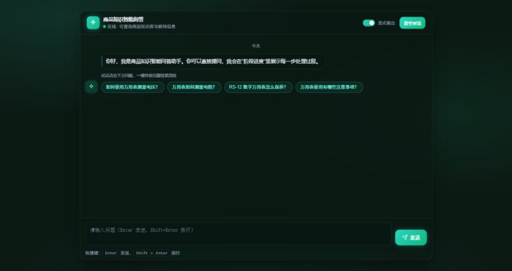
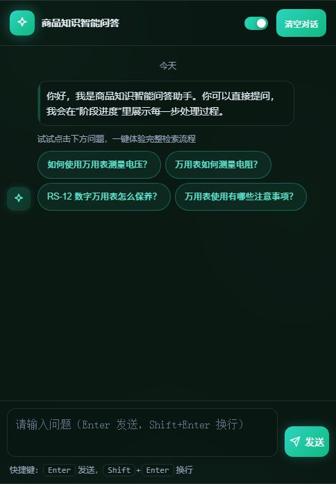
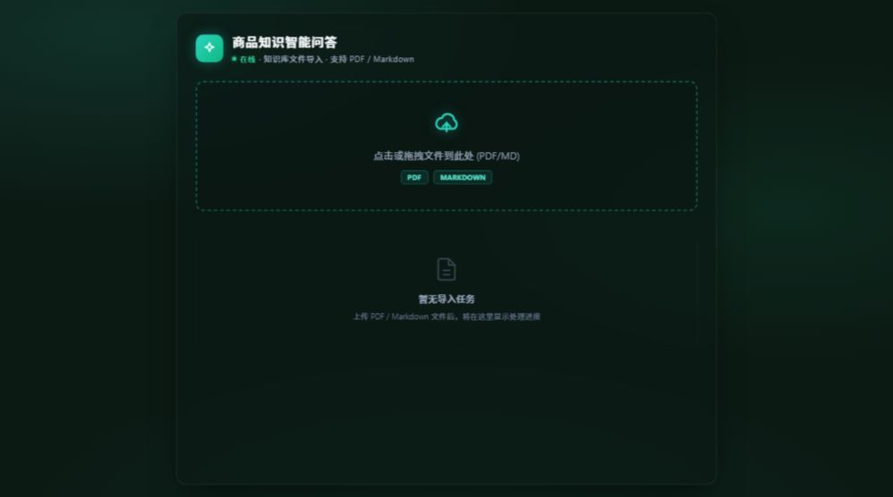
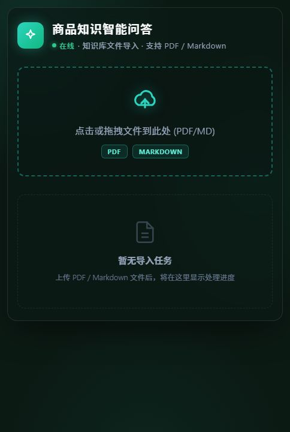

# 商品知识库智能问答系统（RAG）

基于 **RAG（检索增强生成）** 的商品知识库智能问答系统：将 PDF / Markdown 商品说明书转化为可检索的结构化知识，通过多路召回 + 融合重排 + 大模型生成，提供带依据的流式问答体验。

> 解决什么问题：商品资料多、人工翻手册效率低；客服/售后答疑依赖经验。本系统让知识"入库即可问"，答案可溯源、可图文联动。

**适用场景**：产品手册问答、技术文档检索、售后客服支持、企业内部知识库。

---

## 效果预览

| 聊天问答页（桌面） | 聊天问答页（移动） |
| --- | --- |
|  |  |

| 文件导入页（桌面） | 文件导入页（移动） |
| --- | --- |
|  |  |

---

## 功能清单

- **多格式文档导入**：支持 PDF / Markdown 上传，自动完成解析、切分、向量化入库
- **混合向量检索**：BGE-M3 同时产出稠密 + 稀疏向量，兼顾语义匹配与关键词精确命中
- **多路召回融合**：向量检索 + HyDE 查询改写 + MCP 联网搜索 → RRF 加权融合 → Reranker 精排
- **商品级语义路由**：检索前置 LLM 识别并确认商品名，将问答锚定到具体商品说明书
- **流式问答**：SSE 实时逐 token 输出，前端同步展示每个检索阶段的处理进度
- **图文联动**：文档内图片由 VLM 生成语义摘要入库，答案中自动解析并渲染图片引用
- **会话历史**：多轮追问、历史持久化与一键清空

---

## 技术栈

- **后端**：Python、FastAPI、LangGraph（双工作流编排）、SSE
- **检索**：BGE-M3、Milvus、BGE-Reranker、HyDE、MCP
- **模型**：通义千问（OpenAI 兼容协议）、VLM、MinerU（PDF 解析）
- **存储**：MongoDB（会话历史）、MinIO（文件与图片）

---

## 项目亮点

- **双工作流状态图编排**：基于 LangGraph 构建「导入处理」「查询问答」两条独立工作流，节点化封装解析、切分、向量化、检索、生成等阶段；配合异步任务调度与任务状态机，前后端实时同步各阶段进度，链路可观测、易维护。
- **混合检索与多级精排**：BGE-M3 单模型产出稠密 + 稀疏向量，叠加 HyDE 查询改写与 MCP 联网检索形成多路召回，经 RRF 加权融合、BGE-Reranker 精排及分数阈值截断，缓解长尾商品名与专业术语导致的检索漂移。
- **商品级语义路由**：问答前置由 LLM 识别并确认目标商品名，将检索范围锚定到具体商品说明书，配合「文档块库 + 商品名库」两级索引实现垂直知识隔离，抑制相似商品内容交叉干扰。
- **多模态知识入库**：PDF 经 MinerU 转 Markdown，文档内图片由 VLM 生成语义摘要存入 MinIO，答案输出时自动解析图片引用并随文渲染，构建图文联动问答链路。
- **流式问答与会话管理**：SSE 流式 / 非流式双模式输出，前端实时渲染进度与分块结果；会话历史基于 MongoDB 持久化，支持多轮追问与历史恢复。

---

## 目录结构

```
shopkeeper-1002/
├── README.md
├── docs/images/               # 效果截图
└── knowledge/                 # 项目主体（knowledge 包，在项目根目录下运行）
    ├── api/
    │   ├── import_api.py      # 导入服务（端口 8000）
    │   └── query_api.py       # 查询服务（端口 8001）
    ├── core/                  # 依赖注入、路径配置
    ├── processor/
    │   ├── import_processor/  # 导入工作流（LangGraph）
    │   │   ├── main_graph.py  # 导入流程编排
    │   │   ├── state.py       # 导入状态定义
    │   │   └── nodes/         # PDF转MD / 图片摘要 / 切分 / 商品识别 / 向量化 / 入库
    │   └── query_processor/   # 查询工作流（LangGraph）
    │       ├── main_graph.py  # 查询流程编排
    │       ├── state.py       # 查询状态定义
    │       └── nodes/         # 商品确认 / 向量检索 / HyDE / 联网 / RRF / 重排 / 答案生成
    ├── service/               # 业务服务层（导入、查询）
    ├── schema/                # Pydantic 请求/响应模型
    ├── prompts/               # 提示词模板
    ├── utils/                 # 工具库（Milvus / Mongo / MinIO / SSE / 任务 / 模型客户端）
    ├── front/                 # 前端页面（chat.html / import.html）
    ├── test/                  # 测试目录
    ├── docs/                  # 项目文档
    ├── .env                   # 环境配置（按本机填写）
    └── requirements.txt       # Python 依赖
```

---

## 运行步骤

### 环境要求

| 依赖 | 要求 |
| --- | --- |
| Python | >= 3.10 |
| 内存 | >= 16GB（建议 32GB） |
| 显存 | >= 8GB（BGE-M3 + Reranker 推理） |
| 存储 | >= 50GB（模型缓存） |
| 外部服务 | Milvus（向量库）、MongoDB（历史）、MinIO（对象存储） |

### 1. 克隆项目

```bash
git clone <你的仓库地址>
cd shopkeeper-1002
```

### 2. 创建虚拟环境并安装依赖

```bash
python -m venv .venv
# Windows
.venv\Scripts\activate
# Linux / macOS
source .venv/bin/activate

pip install -r knowledge/requirements.txt
```

### 3. 启动依赖服务

需自行准备并启动 **Milvus / MongoDB / MinIO** 三个服务（本机安装或 Docker 均可）。

### 4. 配置环境变量

复制并按本机环境填写 `knowledge/.env`，关键配置项：

```ini
# ====== LLM API 配置 ======
OPENAI_API_KEY=sk-xxx                        # 通义千问 API Key
OPENAI_API_BASE=https://dashscope.aliyuncs.com/compatible-mode/v1
LLM_DEFAULT_MODEL=qwen-flash
VL_MODEL=qwen3-vl-flash

# ====== BGE 模型路径 ======
BGE_M3_PATH=/path/to/bge-m3                  # 本地模型路径
BGE_RERANKER_LARGE=/path/to/bge-reranker-large
BGE_DEVICE=cuda:0                            # GPU 推理

# ====== Milvus / MongoDB / MinIO ======
MILVUS_URL=http://localhost:19530
MONGO_URL=mongodb://localhost:27017
MONGO_DB_NAME=kb001
MINIO_ENDPOINT=localhost:9000
MINIO_ACCESS_KEY=minioadmin
MINIO_SECRET_KEY=minioadmin
MINIO_BUCKET_NAME=knowledge-base
```

### 5. 启动服务

在项目根目录（`shopkeeper-1002/`）执行：

```bash
# 导入服务（端口 8000）
python -m knowledge.api.import_api

# 查询服务（端口 8001）
python -m knowledge.api.query_api
```

### 6. 访问页面

- 文件导入页：`http://127.0.0.1:8000/front/import.html`
- 聊天问答页：`http://127.0.0.1:8001/front/chat.html`

---

## 接口文档

### 导入服务（端口 8000）

| 方法 | 路径 | 说明 |
| --- | --- | --- |
| POST | `/upload` | 上传 PDF / Markdown 文件，返回任务 ID |
| GET | `/status/{task_id}` | 查询导入任务状态与进度 |

**示例 — 上传文件**

```http
POST /upload
Content-Type: multipart/form-data

file: <万用表使用手册.pdf>
```

```json
{ "message": "上传成功", "task_id": "task_001" }
```

**示例 — 查询任务状态**

```http
GET /status/task_001
```

```json
{
  "task_id": "task_001",
  "status": "processing",
  "message": "正在向量入库..."
}
```

### 查询服务（端口 8001）

| 方法 | 路径 | 说明 |
| --- | --- | --- |
| POST | `/query` | 发起查询（流式 / 非流式） |
| GET | `/stream/{task_id}` | SSE 订阅流式答案 |
| GET | `/history/{session_id}` | 获取会话历史 |
| DELETE | `/history/{session_id}` | 清空会话历史 |

**示例 — 发起查询（非流式）**

```http
POST /query
Content-Type: application/json
```

```json
{
  "query": "万用表如何测量直流电压？",
  "session_id": "sess_001",
  "is_stream": false
}
```

```json
{
  "message": "查询请求已处理完成",
  "session_id": "sess_001",
  "answer": "测量直流电压的步骤如下：\n1. 将旋钮调至 V= 档位……",
  "done_list": ["item_name_confirm", "vector_search", "rrf_merge", "rerank", "answer_output"]
}
```

**示例 — 流式查询**：`is_stream: true` 后通过 `GET /stream/{task_id}` 订阅 SSE 事件（`progress` 推送阶段进度、`delta` 推送答案增量、`final` 推送最终结果）。

---

## FAQ

**Q：启动时报连接 Milvus 失败？**
A：确认 Milvus 服务已启动，并检查 `knowledge/.env` 中 `MILVUS_URL` 与集合名是否配置正确。

**Q：模型加载很慢或显存不足？**
A：首次加载 BGE-M3 / Reranker 会较慢属正常；检查 `BGE_M3_PATH`、`BGE_RERANKER_LARGE` 路径是否正确，必要时调整 `BGE_DEVICE`、`BGE_FP16`。

**Q：导入完成但检索不到内容？**
A：确认导入任务状态为 `completed`；检查向量库集合名在导入与查询两侧的 `.env` 配置一致。

**Q：前端页面打不开？**
A：需先启动两个服务（8000 / 8001）后访问 `/front/` 路径；若直接双击 HTML 文件打开（file://），需将页面内 `API_BASE` 改为对应服务地址。

---

## TODO / 未来计划

- [ ] 接入 RAGAS 等评测框架，量化检索与回答效果
- [ ] 增量索引与文档热更新，支持知识库在线维护
- [ ] Docker Compose 一键编排依赖服务与模型环境
- [ ] 支持 Excel、图片等更多格式，扩展多模态问答能力

---

## 联系方式 / 声明

- GitHub：<你的 GitHub 链接>
- Email：<你的邮箱>

> 本项目基于学习与实践目的开发，技术栈与实现思路参考公开教程，代码可自由学习交流。
